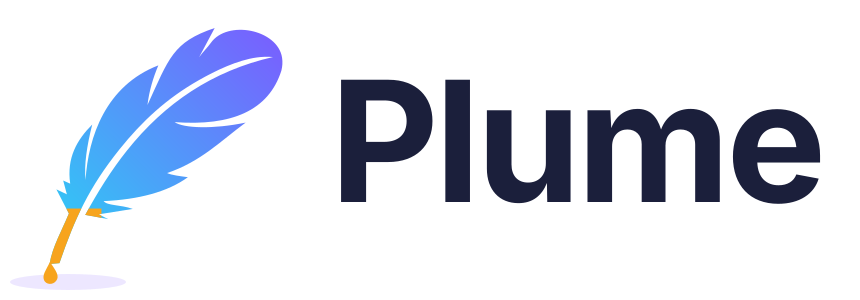
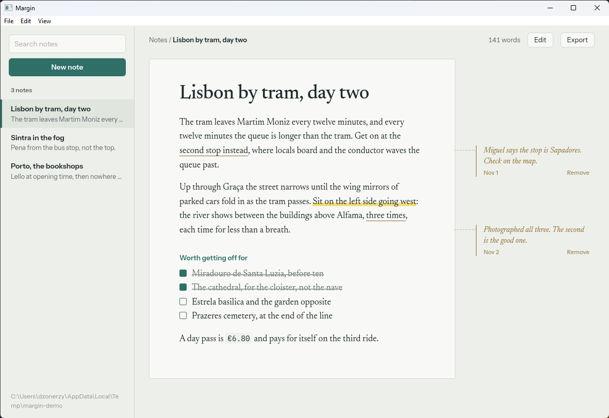
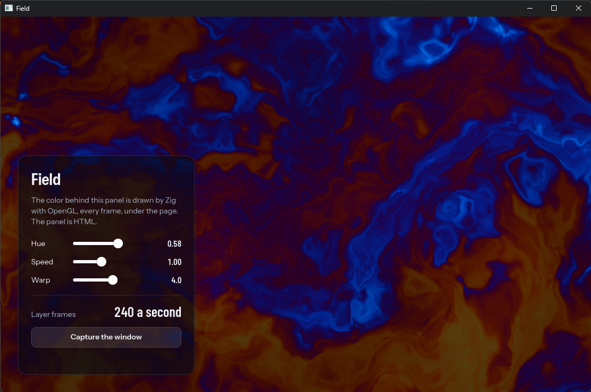

<p align="center">
  <picture>
    <source media="(prefers-color-scheme: dark)" srcset="docs/assets/logo/logo-dark.svg">
    
  </picture>
</p>

<p align="center">
  <b>Desktop applications in Zig with a web frontend: one process, one executable, no runtime to install.</b>
</p>

<p align="center">
  <a href="https://github.com/dzonerzy/plume/actions/workflows/ci.yml"></a>
  <a href="https://dzonerzy.github.io/plume/"></a>
  
  <a href="https://github.com/dzonerzy/ZeroG"></a>
  
  
</p>

---

Plume builds desktop applications the way Wails and Tauri do, with your logic in
Zig and your interface in HTML, CSS and TypeScript, on the
[ZeroG](https://github.com/dzonerzy/ZeroG) engine: WebKit linked statically into
your executable. Zig functions are callable from the page with exact TypeScript
types generated at compile time; windows, menus, the tray, notifications and
installers come with it.

Documentation: **https://dzonerzy.github.io/plume/**

[](examples/margin)

<p align="center"><sub><a href="examples/margin">Margin</a>, notes in Markdown files with notes in their margins: a real app of the examples, with its UI tests. More in <a href="SHOWCASE.md">SHOWCASE.md</a>.</sub></p>

> Version 0.2: the `plume` tool, templates, bindings, events, the page from Zig,
> the desktop (windows, dialogs, menus, tray, notifications, global shortcuts,
> start at login), UI tests, native layers, installers, code signing and signed
> updates. Early days: the API may still change between 0.x versions. macOS is
> not supported yet.

## Why Plume

Wails and Tauri draw your page with the system's web view: WebView2 on Windows,
WebKitGTK on Linux, WKWebView on macOS; Electron ships Chromium beside your
app in several processes. Plume links one web engine, ZeroG's WebKit, into your
executable, and that changes what an app can do:

| | Plume | Wails, Tauri | Electron |
| --- | --- | --- | --- |
| The engine | the same on every system, pinned with your app | the system's, different on each | Chromium, bundled |
| What users install | one executable | the app, and WebView2 or the right WebKitGTK | the app and its runtime (100 MB+) |
| Calls between code and page | function calls in one process, sync or async; Zig reads and changes the page's objects | messages between processes, async | messages between processes (IPC) |
| UI tests | built in: the app headless, no display, real input, snapshots that match pixel for pixel across systems | a browser driver (WebDriver) per system | Playwright, a display |
| GPU content under the page | a native layer: your OpenGL under your HTML | no | WebGL in the page |

- **UI tests without a display.** [`plume test`](https://dzonerzy.github.io/plume/guides/testing/)
  runs your app with no window: real clicks and keys into the engine, the
  page's clock under the test's control, snapshots compared. With bundled fonts
  one snapshot serves Windows and Linux: the pixels are the same.
- **A native layer.** [Zig draws with OpenGL under the page](https://dzonerzy.github.io/plume/guides/native-layer/),
  every frame, and the HTML interface sits on top: viewers, maps, games,
  instruments.
- **One file.** No WebView2 bootstrapper, no WebKitGTK version to match: the
  executable runs on any Windows 10 or any Linux with glibc 2.28.

## Requirements

- Zig 0.17
- Node.js 20 or later, with npm
- Windows 10 1809 or later (x64; Visual Studio's C++ build tools for the
  system libraries), or Linux x86_64 with glibc 2.28 or later

The engine comes from ZeroG's release packages, fetched by `zig build` for the
target and profile you build (`build.zig.zon`). To build with an engine of your
own (a ZeroG build being worked on), set `PLUME_ZEROG_DIR` to a directory of
unpacked packages named `<os>-<profile>` (`windows-minimal`, `linux-dev`...).

## The plume tool

Download it from the [releases](https://github.com/dzonerzy/plume/releases) and
rename it `plume` (`plume.exe` on Windows), or build it:

```sh
zig build cli -Doptimize=ReleaseSmall   # zig-out/bin/plume: put that folder on PATH
```

A project's `npm run dev` and `npm run build` call `plume` by name; `plume
doctor` says whether it is on PATH.

```sh
plume init notes --template react   # or vanilla, svelte, vue (alias: plume new)
cd notes
plume dev                           # the app on Vite's dev server: live reload,
                                    # Zig changes rebuild and restart it
plume build                         # build/bin/notes(.exe), the frontend inside
plume build --compress              # the same, compressed with UPX (--compress=best: smaller, minutes)
plume test                          # the UI tests (src/tests.zig), headless
plume package                       # installers and packages in build/package/
plume update keygen                 # the key pair of signed updates
plume doctor                        # checks Zig, Node.js, npm and git
```

Every template uses Vite, TypeScript and Tailwind CSS. A project looks like
this:

| Path | |
| --- | --- |
| `plume.json` | name, title, `app_id`, `version`, window size and flags, engine profile, `compress`; for packages `publisher`, `description`, `file_associations`, `protocols`; `update` |
| `src/main.zig`, `src/app.zig` | the application; `App`'s `pub fn`s are the bindings |
| `frontend/` | the Vite project; `frontend/src/bindings.ts` is generated at every build |
| `package.json` | npm workspaces and scripts: `npm run dev`, `npm run build` call plume |
| `build.zig`, `build.zig.zon` | `plume.addApp`, with Plume as a Zig dependency |

`plume build` runs the frontend's build (and type check), packs `frontend/dist`
into the executable, and links the engine. On Windows the result is a GUI
application without a console, with the project's icon, version information
from `plume.json` and a manifest (per-monitor DPI, UTF-8, long paths). Set
`PLUME_SMOKE=1` to make an app quit once its page has loaded, exiting with
status 1 if it failed: useful in CI.

## Packages

`plume package` builds, then packages for users into `build/package/`:

| | |
| --- | --- |
| Windows | a per-user installer made with [NSIS](https://nsis.sourceforge.io) (`makensis`): Start menu shortcut, uninstaller, file associations and URL protocols in the user's registry; a zip without NSIS |
| Linux | a `.deb` (`/usr/bin`, a `.desktop` file with the MIME types and URL schemes, the icon, MIME definitions for the application's own file types), a `.tar.gz` of the same tree, and an AppImage when `appimagetool` is installed |

`--format nsis|zip|deb|tar|appimage` picks some. From `plume.json`:

```json
"version": "1.2.0",
"publisher": "Example Inc.",
"description": "Notes, in Markdown",
"file_associations": [{ "ext": "note", "name": "Note" }, { "ext": "md", "name": "Markdown", "mime": "text/markdown" }],
"protocols": ["notes"]
```

Opened with a file or a `notes://` link, the application gets it as an argument
(`app.args`, `Plume.app.args()`); with `"single_instance": true` and already
running, in `app.onSecondInstance`.

`"signing": { "certificate": "notes.pfx" }` (or a store certificate's
`thumbprint`) signs the executable and the installer with `signtool`,
timestamped.

## UI tests

```zig
test "greeting someone" {
    const h = try plume.testing.Harness.startProject(@import("plume_project"), .{});
    defer h.stop();
    var state: App = .{};
    try h.app.bind("App", App, &state);
    try h.open();
    try h.typeText("#name", "Ada");
    try h.click(".ask .action");
    try h.expectText(".answer", "Hello, Ada.");
    try h.snapshotElement("answer", ".answer");
}
```

`plume test` runs them with the app headless: no window, no display, real input
into the engine, animations on the test's clock, snapshots compared (and
identical across systems for apps that bundle their fonts). See
[UI tests](https://dzonerzy.github.io/plume/guides/testing/).

## The native layer

```zig
const app = try plume.App.init(.{ .native_layer = true, ... });
try app.window().setLayer(&scene, Scene.draw);   // OpenGL ES 3, every frame, under the page
```

[](examples/layer)

Zig draws into the window with OpenGL ES 3 and the page is blended over it:
the HTML interface on top of your own GPU content. `window.capture` and the
page's `Plume.window.capture()` give the window as the user sees it, as a PNG.
See [the native layer](https://dzonerzy.github.io/plume/guides/native-layer/).

## Updates

Signed updates from the application's GitHub releases:

```sh
plume update keygen     # update.key (secret: CI's PLUME_UPDATE_KEY) and the public key
```

```json
"update": { "github": "owner/notes", "public_key": "<the public key>" }
```

`plume package` then also writes the executable as an update with its
Ed25519 signature (`notes-1.2.0-windows-x64.exe` and `.sig`,
`notes-1.2.0-linux-x64` and `.sig`): attach them to the release tagged
`v1.2.0`. The application checks and installs:

```ts
const release = await Plume.updates.check();   // { version, notes } or null
if (release) {
  await Plume.updates.install(release);        // download, signature, swap
  Plume.updates.restart();
}
```

(`app.checkForUpdate`, `app.installUpdate` and `app.restart` from Zig, on a
worker thread.) An update whose signature does not match is refused; the new
executable must start and give its version before it takes the old one's
place (the old one is kept as `.old` until the next start).

## Try the example

```sh
zig build hello                     # a window whose page calls a Zig function
zig build hello -Dprofile=dev       # with the Web Inspector (F12)
zig build showcase -- kiln          # a mockup of SHOWCASE.md (margin, spindle, kiln, gauge)
zig build margin                    # Margin, notes in Markdown files (a real app)
zig build margin-test               # its UI tests, headless
zig build layer                     # OpenGL drawn by Zig under the page
zig build ui-test                   # plume.testing's own tests
zig build -Doptimize=small          # the release build
```

On Linux you can also cross-compile from Windows:
`zig build -Dtarget=x86_64-linux-gnu.2.28`.

## Bindings

A Zig type's `pub fn`s become JavaScript functions, generated at compile time,
with exact TypeScript types:

```zig
pub const App = struct {
    pub const async_methods = .{"listFiles"}; // on a worker thread, a Promise

    pub fn greet(self: *App, allocator: std.mem.Allocator, name: []const u8) ![]const u8 {
        return std.fmt.allocPrint(allocator, "Hello, {s}", .{name});
    }
    pub fn listFiles(self: *App, dir: []const u8) ![]FileEntry { ... }
};

try plume.bind(view, "App", App, &app);
```

```ts
import { App, PlumeError } from "./bindings";
const message: string = App.greet("Plume");            // synchronous
const files: FileEntry[] = await App.listFiles("/tmp"); // a Promise
```

| Zig | TypeScript |
| --- | --- |
| `bool` | `boolean` |
| integers, floats | `number` (`bigint` past 53 bits, passed directly) |
| `[]const u8` | `string` |
| slices, arrays | `T[]` |
| structs | `interface` |
| enums | `"a" \| "b"` |
| `union(enum)` | `{ tag: "a"; value: T } \| ...` |
| `?T` | `T \| null` |
| `plume.Bytes` | `Uint8Array` (inside objects: `number[]`) |
| errors | `PlumeError` with the error's name as `code` |

A parameter of type `std.mem.Allocator` gets the call's arena: results need no
freeing. A parameter of type `plume.Page` gets the calling page (see below).

Two methods are the application's rather than the page's: `startup(self, app:
*plume.App)` runs when `app.run()` starts, before the page loads, and
`shutdown(self)` when the app ends.

## Events

Events go both ways, with their names and data declared once, in the binding
type:

```zig
pub const App = struct {
    pub const Events = struct {
        progress: Progress,   // Zig → page
        cancel: void,         // page → Zig
    };
    ...
};

const events = window.events(App.Events);
events.emit(.progress, .{ .done = 3, .total = 10 });   // from any thread
try events.on(.cancel, &job, Job.cancel);              // runs on the runtime thread
```

```ts
import { Events } from "./bindings";
const stop = Events.on("progress", (p) => bar.value = p.done / p.total); // p: Progress
Events.emit("cancel");
```

`Events.emit` reaches Zig's handlers and the page's own listeners. Without an
`Events` declaration, `app.emit(name, value)`, `app.on(name, T, ...)` and the
page's `Plume.on`/`Plume.emit` take any name. Events from worker threads keep
their order. `app.dispatch(context, function)` runs Zig code on the runtime
thread, from a worker thread for instance.

## The page from Zig

`plume.Page` reads and changes the page's objects as JavaScript would. A sync
binding gets the calling page by declaring a parameter of that type, and
`app.page()` opens it elsewhere on the runtime thread:

```zig
pub fn rename(self: *App, page: plume.Page, title: []const u8) !void {
    const heading = try page.byId("title");      // error.NotFound if missing
    try heading.set("textContent", title);
    try heading.set("style.color", "tomato");
    const items = try page.queryAll("li.done");  // []plume.Ref
    const width = try (try page.window()).getNumber("innerWidth");
    const words = try (try page.window()).call("String.prototype.split.call", .{ title, " " });
    const list = try words.as([]const []const u8);
    ...
}
```

References and strings live until the page is closed: after the call for a
binding's page, at `page.close()` for one from `app.page()`.

## The desktop

From Zig, on the runtime thread (from a worker thread, through
`app.dispatch`):

```zig
const window = app.window();
try window.setSize(.{ .width = 900, .height = 600 });
try window.center();
try app.onWindow(&state, State.windowEvent);   // resized, moved, focus, state, screen, files_dropped
app.onClose(&state, State.mayClose);            // return false to keep the window open

try app.setMenu(&.{
    plume.menu.submenu("&File", &.{
        plume.menu.item("open", "&Open…", "Ctrl+O"),
        plume.menu.separator,
        plume.menu.item("quit", "E&xit", null),
    }),
    plume.menu.submenu("&View", &.{plume.menu.checkbox("dark", "&Dark mode", false)}),
});
try app.onMenu(&state, State.menuChosen);       // menuChosen(state, "open")

try app.fileDialog(.{ .kind = .open, .filters = &.{.{ .name = "Images", .pattern = "png;jpg" }} }, &state, State.opened);
try app.clipboard().writeText("copied");
const screens = try app.screens(allocator);

// More windows, with the same bindings; closing one destroys it.
const settings = try app.openWindow(.{ .title = "Settings", .width = 480, .height = 360, .url = "settings.html" });

// A tray icon (the application's icon unless given), its menu as a window's.
const tray = try app.createTray(.{ .tooltip = "Notes", .menu = &.{ plume.menu.item("show", "&Show", null), plume.menu.item("quit", "E&xit", null) } });
tray.attachWindow(app.window());               // a click shows it by the icon, the next hides it

try app.notify(.{ .title = "Saved", .body = "notes.md", .tag = "save", .actions = &.{"Open"} });
try app.onNotification(&state, State.notificationClicked);
try app.registerShortcut("capture", "Ctrl+Shift+K"); // anywhere, whichever app has the keyboard
try app.onShortcut(&state, State.shortcut);
try app.setStartAtLogin(true);
try app.openURL("https://ziglang.org");          // the browser; links to other sites do this too
try app.setContextMenu("note", &.{ plume.menu.item("rename", "&Rename", null), plume.menu.item("delete", "&Delete", null) });
```

From the page, the same through `Plume` (typed in `bindings.ts`):

```ts
import { Plume } from "./bindings";
Plume.window.toggleMaximize();
Plume.window.on("files-dropped", ({ paths }) => open(paths));
const [file] = await Plume.dialog.open({ filters: [{ name: "Images", extensions: ["png", "jpg"] }] });
const answer = await Plume.dialog.message({ kind: "warning", message: "Discard?", buttons: [{ id: 1, label: "Discard" }, { id: 0, label: "Cancel", cancel: true }] });
const choice = await Plume.menu.popup([{ id: "copy", label: "Copy" }, "separator", { id: "delete", label: "Delete" }], event.clientX, event.clientY);
Plume.clipboard.writeText("copied");
Plume.windows.open({ title: "Settings", url: "settings.html" });
Plume.notifications.show({ title: "Saved", body: "notes.md" });
Plume.shortcuts.register("capture", "Ctrl+Shift+K");
Plume.shortcuts.on((name) => capture());
Plume.app.setStartAtLogin(true);
Plume.openURL("https://ziglang.org");
```

```html
<!-- Zig's "note" context menu on a right click; the choice comes with the data -->
<li data-plume-menu="note" data-plume-menu-data="42">Groceries</li>
<script type="module">Plume.menu.onContext(({ menu, id, data }) => act(id, data));</script>
```

Menus are the system's on Windows, dark with a dark color scheme. On Linux,
where a window has no menu bar of its own, the page runtime draws the same
menus at the top of the page, with their accelerators (`--plume-menu-height`
gives pages the room it takes), and the context menus. In text fields and on
selected text, the engine's context menu (cut, copy, paste) shows as a native
popup on Windows.

The tray is the notification area on Windows and a StatusNotifierItem on
Linux (KDE, GNOME with the AppIndicator extension, most other desktops).
Notifications are toasts on Windows and go through the desktop's notification
service on Linux. Global shortcuts use `RegisterHotKey` on Windows, a key grab
on X11, and the GlobalShortcuts portal on Wayland, where the desktop asks the
user to confirm them. Links to other sites open in the default browser
(`app.onExternalLink` to decide otherwise).

`"single_instance": true` in `plume.json` keeps one instance per user: a second
launch hands its arguments to the first (`app.onSecondInstance`, the page's
`instance:launched` event), which comes to the front. `"color_scheme"` is
`"system"`, `"light"` or `"dark"`. The page's console messages and errors go
to the terminal. `zig build bindings` writes `bindings.ts` (and `bindings.d.ts` for pages
that do not import modules) for `examples/hello`.

## Profiles

| Profile | The web platform |
| --- | --- |
| `minimal` (default) | application UI: no media, WebGL, WebAssembly or service workers |
| `standard` | everything: media, WebGL, WebAssembly, service workers, Web Audio |
| `dev` | standard plus the Web Inspector |

## License

BSD 2-Clause. Applications link the ZeroG engine, whose WebCore and
JavaScriptCore are LGPL: see [LICENSE](LICENSE).

The `plume` executable itself contains [UPX](https://upx.github.io) 5.3.0,
compiled from its sources and called as a library. That makes the executable a
GPLv2+ work. Plume's sources stay BSD, and the applications it builds and
compresses are not affected (UPX's license makes an exception for compressed
programs).
