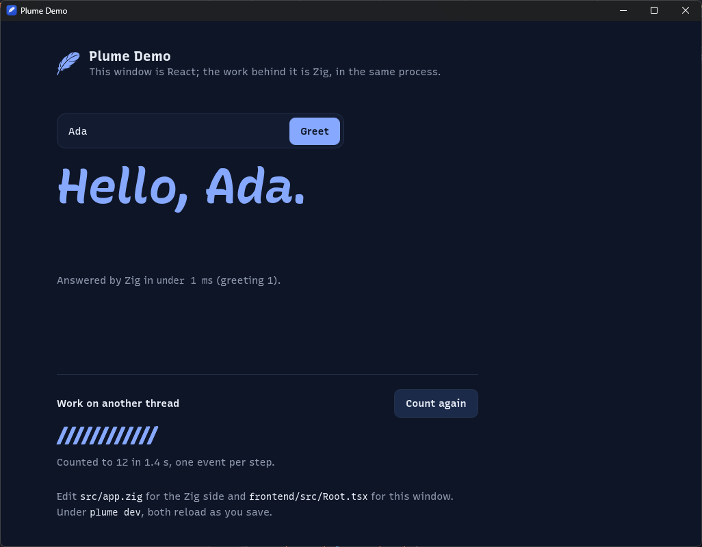
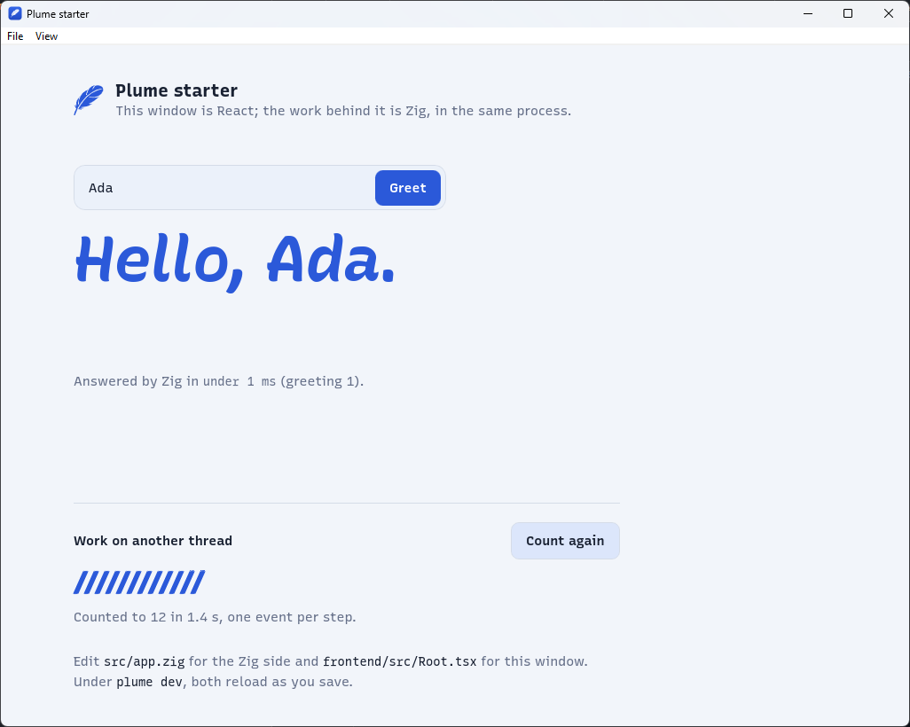
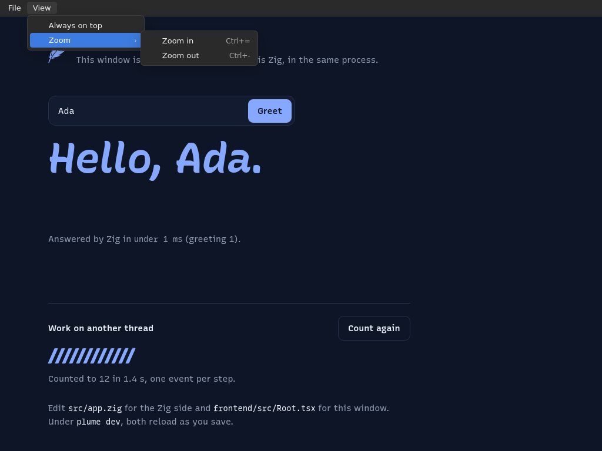

# Showcase

What `plume init` gives you, running. Every screenshot is the React template
(`plume init starter --template react`) built with `plume build`: one
executable, the engine linked in, the frontend inside. The other templates
(vanilla, Svelte, Vue) look the same.

## Windows

The window after a greeting and a count. Zig answered the greeting in the same
process, under a millisecond; the twelve bars are twelve events a Zig worker
thread sent while it counted.



The same app, light, with a menu bar defined in Zig (below). On Windows the
menus are the system's own.



## Linux

The same app on Linux (X11), dark. A window there has no menu bar of its own,
so Plume's page runtime draws the one defined in Zig, submenus and
accelerators included, in the page's light or dark.



## The menu bar

The only change to the template for the screenshots with menus, in
`src/main.zig`:

```zig
const menu = plume.menu;
try window.setMenu(&.{
    menu.submenu("&File", &.{
        menu.item("new", "&New window", "Ctrl+N"),
        menu.item("open", "&Open…", "Ctrl+O"),
        menu.separator,
        menu.item("quit", "E&xit", null),
    }),
    menu.submenu("&View", &.{
        menu.checkbox("top", "Always on &top", false),
        menu.submenu("&Zoom", &.{ menu.item("zoom-in", "Zoom &in", "Ctrl+="), menu.item("zoom-out", "Zoom &out", "Ctrl+-") }),
    }),
});
```

A chosen item reaches `window.onMenu` in Zig and the page's `Plume.menu.on`.
