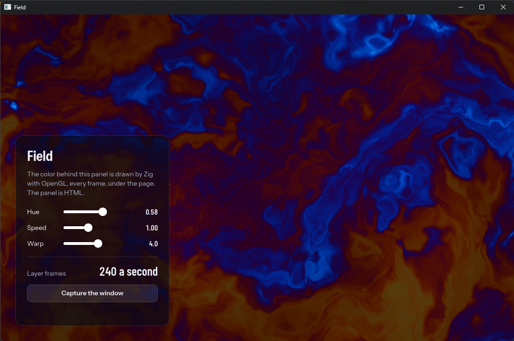

# The native layer

A window can show the application's own GPU drawing under its page: a 3D
scene, a video, a map, a game's viewport, with the interface in HTML over it.
Zig draws with OpenGL ES 3 straight into the window, every frame; the page is
blended over what it drew, and its transparent parts show it.



```zig
const app = try plume.App.init(.{ .title = "Field", .native_layer = true, ... });
var scene: Scene = .{ .window = app.window() };
try app.window().setLayer(&scene, Scene.draw);
```

```zig
fn draw(scene: *Scene, frame: plume.LayerFrame) void {
    const gl = scene.gl orelse blk: {               // loaded once, here
        scene.gl = plume.gl.load(plume.gl.Core) catch return;
        break :blk scene.gl.?;
    };
    gl.glViewport(0, 0, @intCast(frame.width), @intCast(frame.height));
    // ... draw ...
    scene.window.invalidateLayer();                 // the next frame too
}
```

In `plume.json`: `"window": { "native_layer": true }`. The page leaves the parts
the layer shows transparent: no background on `html` and `body`.

## How it runs

- `draw` runs at each frame the window presents, with the window's OpenGL ES 3
  context current, framebuffer 0 bound and the viewport the window's size in
  pixels, cleared to black. The page is composited over it afterwards
  (premultiplied alpha).
- It runs on the engine's compositor thread, not the runtime thread: share
  state with it as with any other thread (atomics, a lock). It must not make
  another GL context current or leave another framebuffer bound.
- It draws when the page has a new frame, or after `invalidateLayer()` (any
  thread, coalesced, at most once per display refresh). For continuous
  animation, call it from `draw`.
- `plume.gl.load(T)` fills a struct of GL function pointers by their names
  (`plume.gl.Core` has the common ones, and constants); `plume.gl.program`
  compiles and links GLSL ES 3.00.

The window is GL on both systems: ANGLE over Direct3D 11 on Windows, the
system's EGL on Linux (Mesa included).

## Captures

`window.capture(context, done)` gives the next presented frame as the user sees
it, layer included (`capture.png()` for a PNG file's bytes); the page has
`await Plume.window.capture()`.

`zig build layer` runs [the example](https://github.com/dzonerzy/plume/tree/main/examples/layer):
a field of flowing color drawn by a shader, with sliders in HTML that set its
uniforms through a binding.
