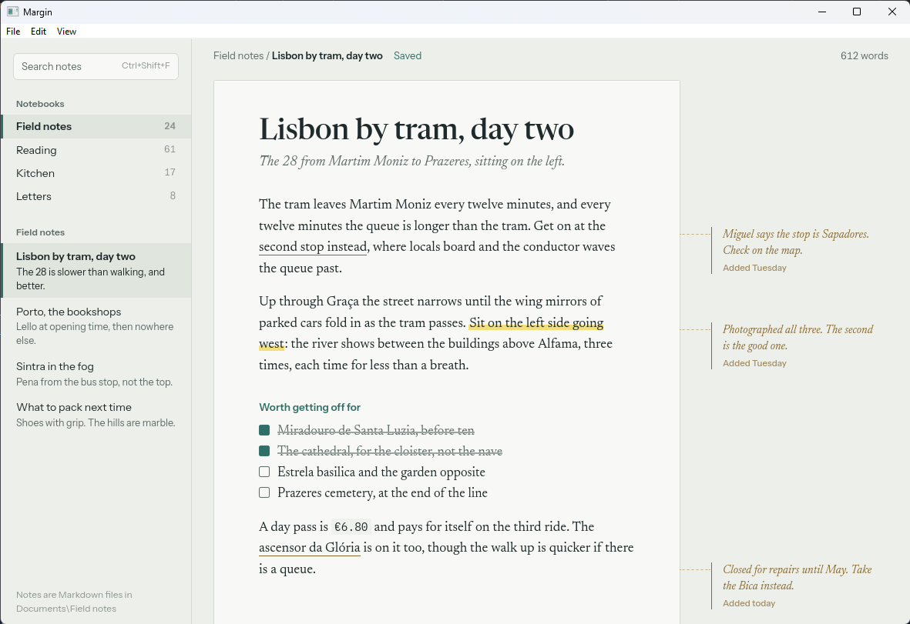

# Plume

<p align="center">
  
  
</p>

Plume builds desktop applications with the logic in Zig and the interface in
HTML, CSS and TypeScript, on the [ZeroG](https://github.com/dzonerzy/ZeroG)
engine: WebKit linked statically into your executable. One process, one
executable, no runtime to install. Windows x64 and Linux x86_64.



```zig
pub const App = struct {
    pub fn greet(self: *App, allocator: std.mem.Allocator, name: []const u8) ![]const u8 {
        return std.fmt.allocPrint(allocator, "Hello, {s}", .{name});
    }
};
```

```ts
import { App } from "./bindings";
const message: string = App.greet("Plume"); // generated, typed, synchronous
```

- **Bindings with exact types.** A Zig type's `pub fn`s are callable from the
  page, synchronously or as Promises; `bindings.ts` is generated from the same
  Zig types at every build.
- **Events both ways**, typed, from any thread.
- **The desktop:** windows, native dialogs, menus, context menus, a tray icon,
  notifications, global shortcuts, single instance, start at login.
- **The whole path to users:** `plume dev` with live reload, `plume build`,
  `plume package` for installers and packages, and signed updates from GitHub
  releases.

Start with [Getting started](getting-started/index.md), or see what could be
built in the [Showcase](showcase.md).
