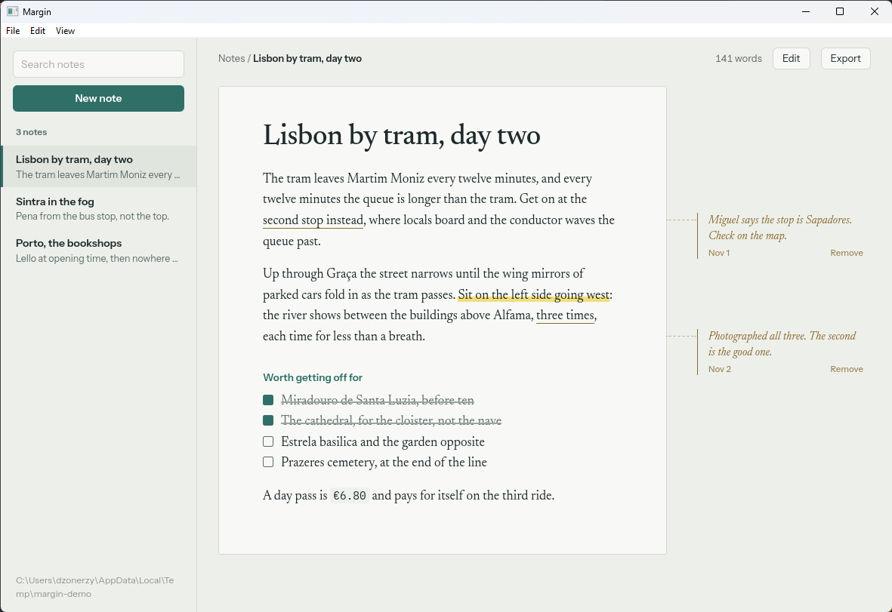
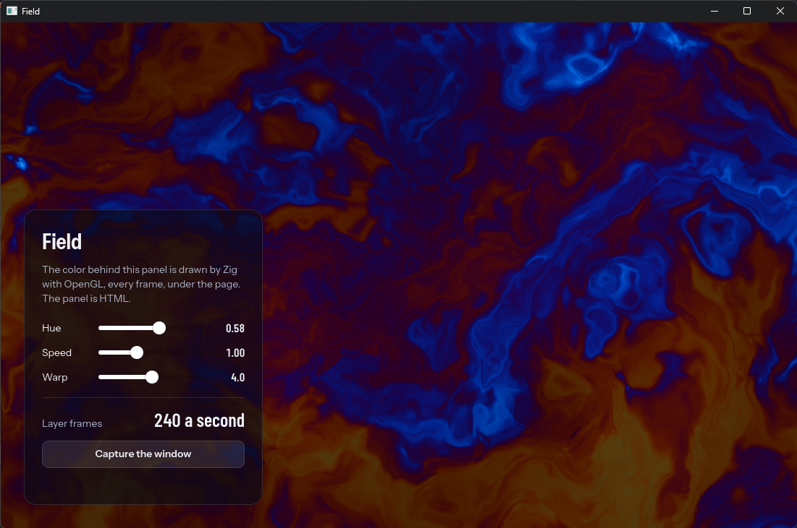
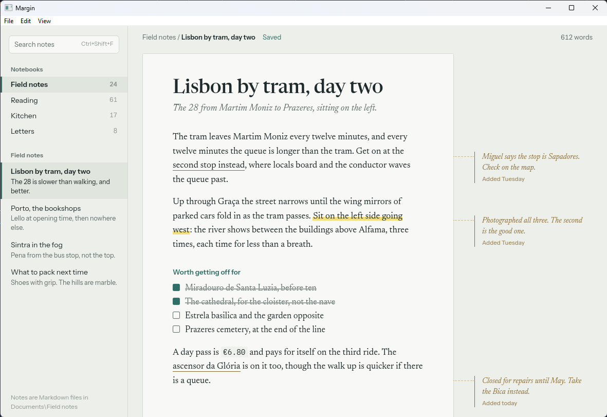
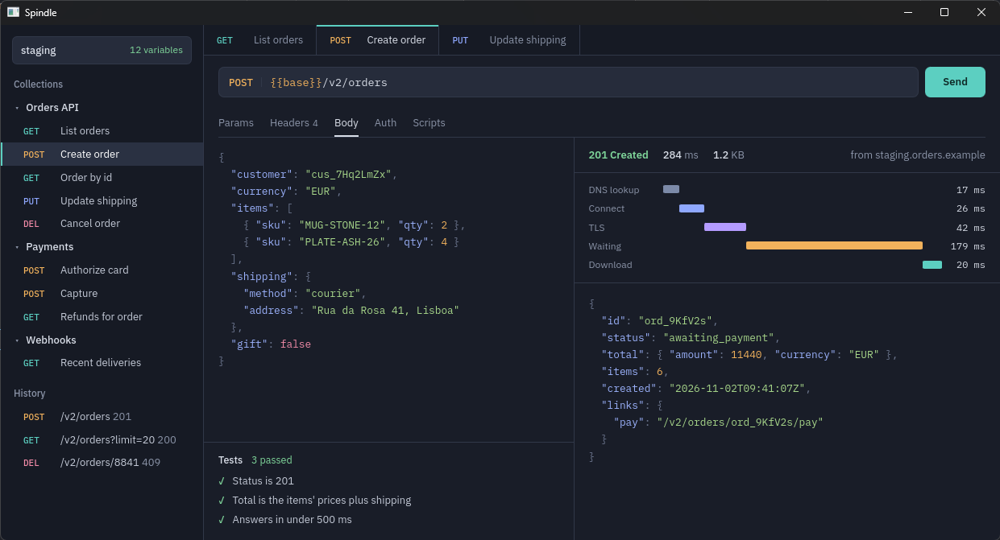
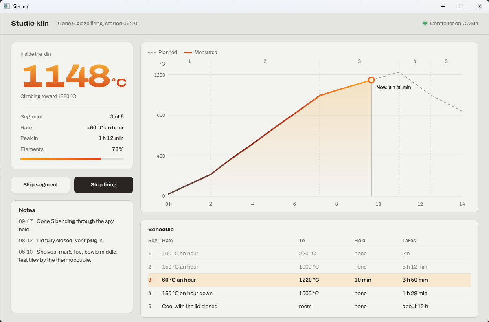
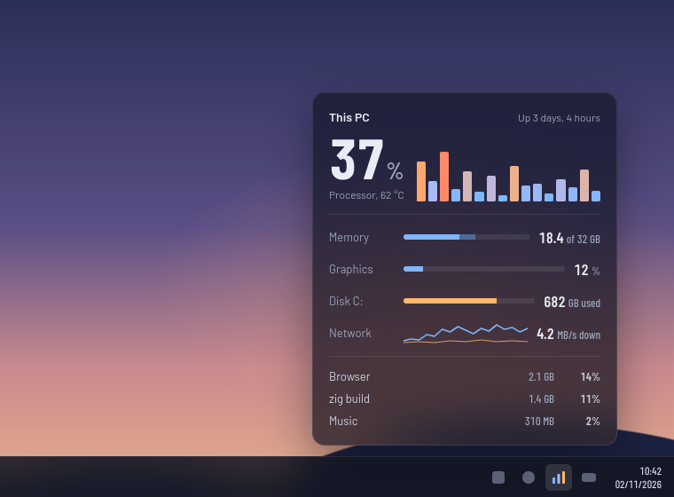
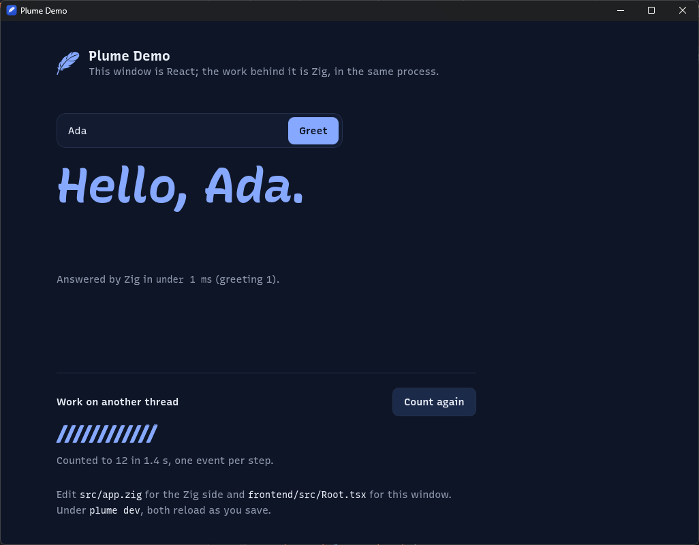
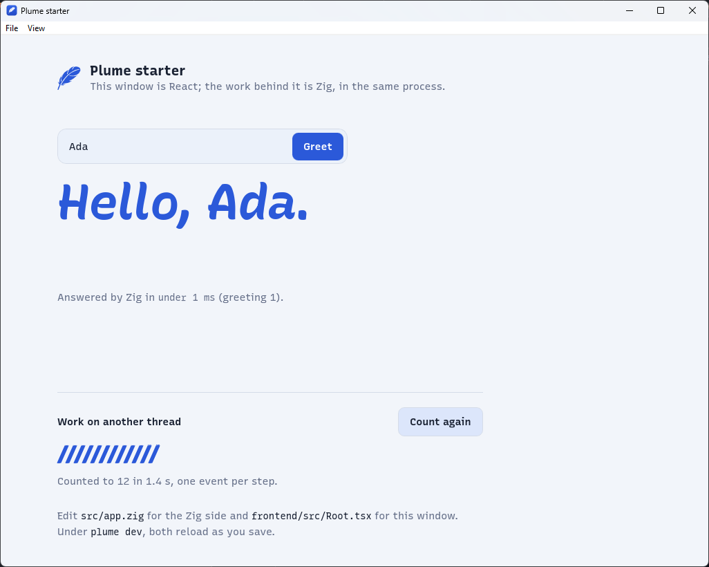
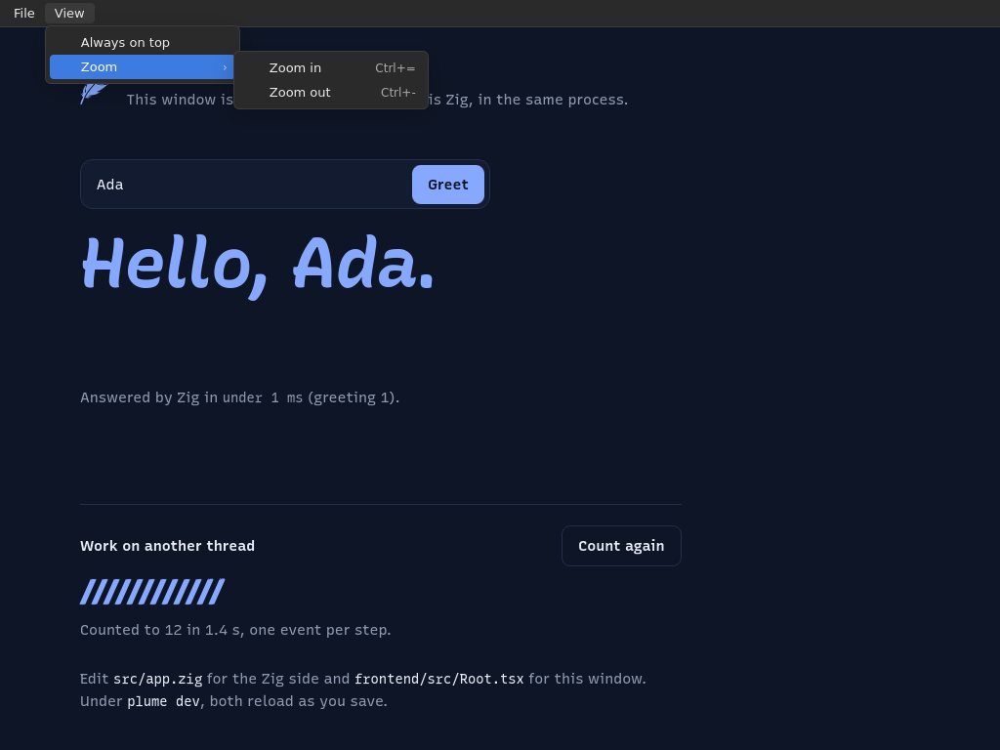

# Showcase

## Real applications

### Margin

[`examples/margin`](https://github.com/dzonerzy/plume/tree/main/examples/margin):
notes as the Markdown files of a folder, margin notes on selected words kept
beside each file, a native menu bar, a tray icon, single instance, the folder
watched, export to HTML with a notification, and UI tests that run headless in
CI with one set of snapshots for Windows and Linux.

### Field: a native layer

[`examples/layer`](https://github.com/dzonerzy/plume/tree/main/examples/layer):
OpenGL drawn by Zig under the page, every frame, with an HTML panel over it
([the native layer](guides/native-layer.md)).

## What you could build

Four applications that could be built with Plume, each needing something only
a desktop application can do. They are mockups, static pages of
[`examples/showcase`](https://github.com/dzonerzy/plume/tree/main/examples/showcase)
with made-up data, but each screenshot is a real Plume window showing it:
`zig build showcase -- margin` in a clone of Plume.

### Margin: notes in Markdown files

Notes are Markdown files in a folder of the user's; Margin opens them from the
file manager (a [file association](guides/packaging.md)), keeps pencil notes in
the margin beside the lines they are about, and lives in the
[tray](guides/desktop.md#the-tray) for a quick note.

### Spindle: an HTTP client

Requests leave from Zig, on a worker thread ([async
bindings](guides/bindings.md#async-bindings)), so without the browser's CORS
limits; each request can open in a [window](guides/windows.md) of its own, and a
[global shortcut](guides/desktop.md#global-shortcuts) brings Spindle forward.

### Kiln log: a pottery kiln on a serial port

Zig reads the kiln controller over USB serial on a thread and sends
[events](guides/events.md) the page draws: the temperature against the
schedule, in the colors of the heat.
[Notifications](guides/desktop.md#notifications) say when the firing peaks.

### Gauge: the machine's load, from the tray

A tray icon whose click shows a small frameless window above it
(`tray.attachWindow`): load per core, memory, disk, network. In the screenshot
the desktop around the window is part of the mockup.

## What plume init gives you

The React template (`plume init starter --template react`) built with
`plume build`, on Windows dark, Windows light with a menu bar defined in Zig,
and Linux, where Plume's page runtime draws the menu bar.

